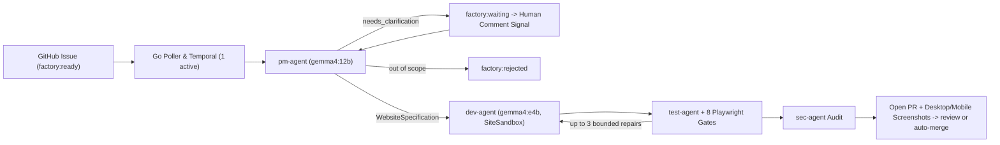

# ai-factory

A local-first, durable, asynchronous **AI Software Factory** built with **Go**, **Temporal**, **PydanticAI**, **LiteLLM**, **Ollama (`gemma4`)**, **Playwright**, and **GitHub Apps** — sized to run reliably on a 36 GB Apple Silicon Mac with zero external LLM API keys.

Customer requests enter as structured GitHub Issues on [`barbarosydev/ai-factory-websites`](https://github.com/barbarosydev/ai-factory-websites), flow through four PydanticAI roles inside isolated git worktrees, verify desktop/mobile rendering across 8 Playwright gates, pause durably for human clarification when needed, and publish portfolio Pull Requests with inline screenshots (or autonomously squash-merge once GitHub Actions pass).



## Portfolio Highlights

- **Durable Multi-Agent Orchestration**: Deterministic Temporal workflow ([issue_workflow.go](internal/workflow/issue_workflow.go), `go tool workflowcheck` clean) separating technical retries (`RetryPolicy`), 15s background heartbeats, durable 7-day human clarification sleeps (`SignalHumanReply`), and bounded 3-attempt semantic self-correction.
- **Hard Security & Sandbox Boundaries**: Zero host shell tool exposed to LLMs; PydanticAI file tools use `SiteSandbox` to confine reads and writes to `sites/<slug>/`; subprocess secrets are scrubbed before Playwright starts.
- **Zero-Dependency GitHub App Auth**: Pure Go stdlib `crypto/rsa` RS256 App JWT minting + 1-hour installation token cache ([auth.go](internal/githubapp/auth.go)) driving `go-github/v93`, ephemeral `GIT_ASKPASS` pushes, Checks API polling, and merged branch cleanup.
- **Grounded Evaluation & Empirical Optimization**: Shared `@playwright/test` verification across desktop (`1280x800`) and mobile (`375x812`) with zero external network access allowed; PydanticAI tools use bundled site references and retain existing content on modify requests.

## Documentation

- **[User & Operator Journey](docs/user-journey.md)** — Customer workflow, operator commands, and verified end-to-end run results
- **[Architecture](docs/architecture.md)** — Cross-repository system view, state machine, and package map
- **[Observability, Evals & Configurability](docs/observability-and-evals.md)** — Arize Phoenix OpenInference traces, LiteLLM `/ui/usage/` correlation, Prometheus `/metrics`, and `FACTORY_*` knobs
- **[Kubernetes & AKS Migration](docs/deployment-k8s-aks.md)** — 12-factor container/probe readiness and multi-GPU cloud scaling path
- **[Prerequisites](docs/prerequisites.md)** & **[GitHub App Setup](docs/github-app-setup.md)** — Fresh-Mac installation and Keychain setup
- **[Operations Runbook](docs/runbook.md)** — Daily startup, monitoring (`task status`), and debugging failed snapshots
- **[AI Agent Harness](docs/harness.md)** — Rules, permissions, Conftest policies, review roles, and tested hooks
- **[Architecture Decision Records](docs/adr/README.md)** — ADRs `0001`–`0010`

## Ecosystem Repositories

| Repository | Role |
| --- | --- |
| **[`ai-factory-infra`](https://github.com/barbarosydev/ai-factory-infra)** | Local platform infrastructure (k3d, CloudNativePG PostgreSQL 18, Temporal, LiteLLM, Arize Phoenix, Ollama Metal GPU, Terraform/Helm) |
| **`ai-factory`** *(this repo)* | Go control plane, PydanticAI Python Temporal worker, Git worktree manager, GitHub App poller, CLI |
| **[`ai-factory-websites`](https://github.com/barbarosydev/ai-factory-websites)** | Target website monorepo (`sites/<slug>/`), root Playwright verification harness, GitHub Issue Forms & Actions CI |

## Quickstart

From a fresh clone (with `../ai-factory-infra` running via `task up` and GitHub App Keychain configured):

```bash
brew bundle --no-upgrade
mise install
pre-commit install

task build
task doctor
task run        # human-review mode (factory:review)
# or: task run:auto
```

## Key Commands

- `task doctor`: Verify Go toolchain, `ai-factory-infra`, GitHub App Keychain auth, and `ai-factory-websites` Playwright readiness.
- `task build`: Compile `./bin/factory`.
- `task run` / `task run:auto` / `task run:once`: Run the worker + FIFO GitHub poller in `review`, `auto`, or single-issue mode.
- `task status`: Inspect active/recent Temporal workflows, Ollama VRAM models, and open `factory:*` issues.
- `task clean:failed`: Remove archived `.worktrees/issue-*-failed-*` snapshots in `../ai-factory-websites`.
- `task ci`: Run all linters (`gofmt`, `go vet`, `golangci-lint`, `workflowcheck`, `shellcheck`, `ruff`, `mypy`, Conftest `policy/`, `actionlint`, doc/command drift checks), Go and Python (`pytest`) unit/workflow/sandbox/hook tests, and `gitleaks`.
