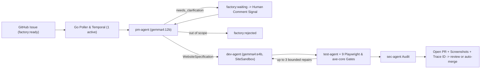
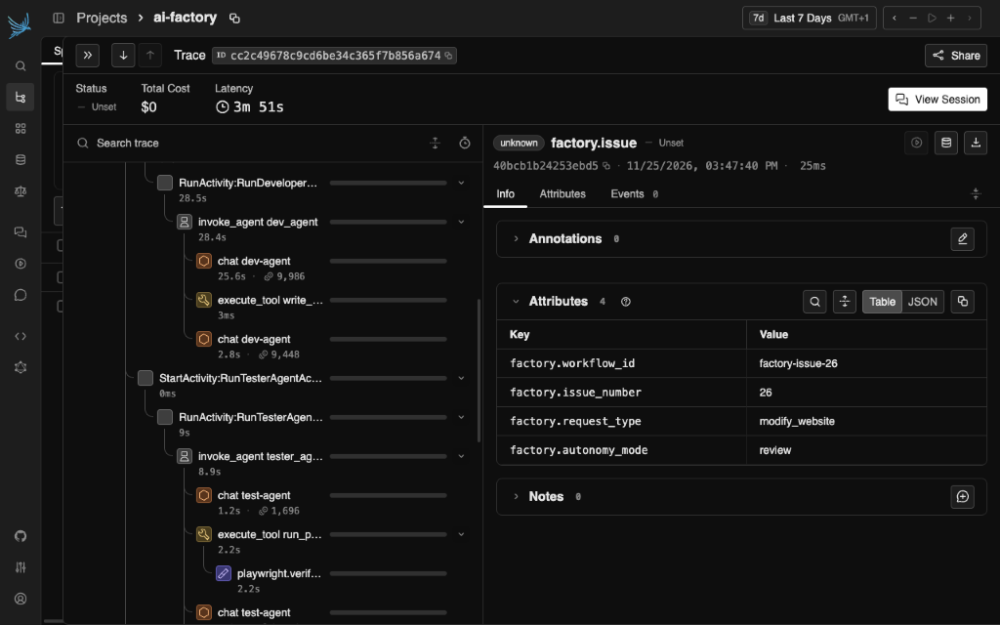
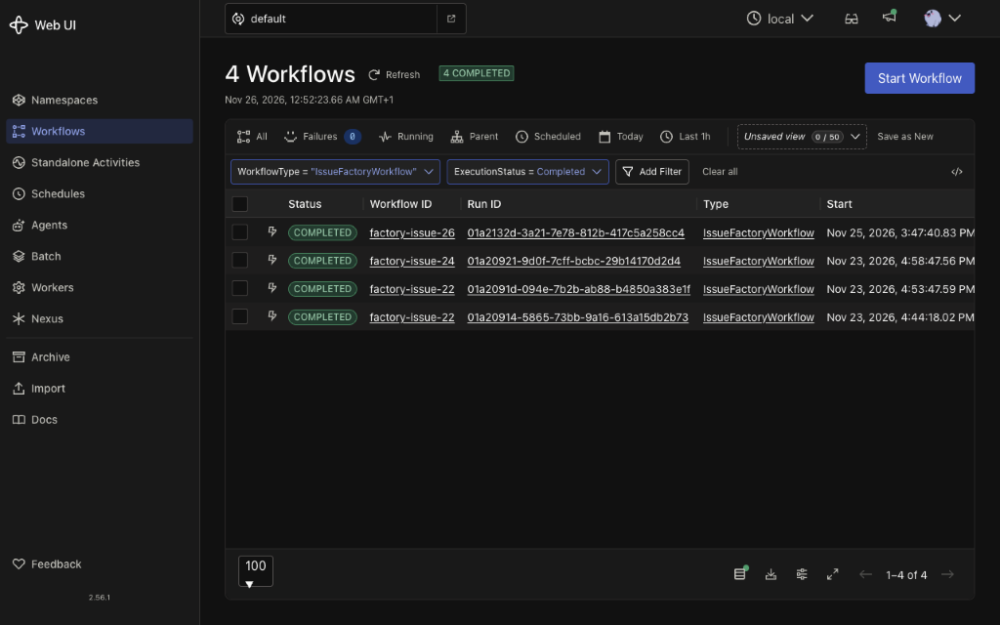

# ai-factory

A local-first, durable, asynchronous **AI Software Factory** built with **Go**, **Temporal**, **PydanticAI**, **LiteLLM**, **Ollama (`gemma4`)**, **Arize Phoenix**, **Promptfoo**, **Playwright + `@axe-core/playwright`**, and **GitHub Apps** — engineered to run reliably on a 36 GB Apple Silicon Mac with zero external LLM API keys.

Customer requests enter as structured GitHub Issues on [`barbarosydev/ai-factory-websites`](https://github.com/barbarosydev/ai-factory-websites), flow through four PydanticAI roles inside isolated git worktrees, verify desktop/mobile layout, zero-external-requests, and WCAG 2.1 AA accessibility across 9 Playwright gates (host or `--network=none` container sandbox), pause durably for human clarification when needed, and publish portfolio Pull Requests with inline screenshots and OpenTelemetry trace provenance.



## Engineering Highlights

- **Durable Multi-Agent Orchestration**: Deterministic Temporal workflow ([issue_workflow.go](internal/workflow/issue_workflow.go), `go tool workflowcheck` clean) separating technical retries (`RetryPolicy`), 15s background heartbeats, durable 7-day human clarification sleeps (`SignalHumanReply`), and bounded 3-attempt semantic self-correction.
- **Defense-in-Depth Security & Sandboxing**: Zero host shell tool exposed to LLMs; PydanticAI file tools confine reads/writes to `sites/<slug>/` via `SiteSandbox`; dual-mode `SandboxRunner` ([sandbox_runner.py](agents_py/src/agents_py/sandbox_runner.py)) supports `FACTORY_SANDBOX_MODE=container` (`docker run --rm --network=none --cap-drop=ALL --security-opt=no-new-privileges --pids-limit=256 --read-only`); `clean_exec_env()` scrubs secrets and `OTEL_*`/`PHOENIX_*` env vars; untrusted GitHub text is wrapped in `<untrusted_github_input>` tags behind `FACTORY_ALLOWED_GITHUB_USERS`.
- **End-to-End OpenTelemetry + Arize Phoenix Observability**: Cross-language W3C `traceparent` propagation stitches Go Temporal spans, Python PydanticAI `OpenInference` spans, and `playwright.verify_site` into one trace waterfall at `http://phoenix.localhost:8080` (`FACTORY_OTEL_CAPTURE_CONTENT=false` metadata-only default), correlated with LiteLLM `/ui/usage/` (`x-litellm-tags`, `x-litellm-trace-id`) and PR `Trace ID` provenance.
- **Offline AI Evaluation & Red-Teaming**: `task eval` runs a 12-case Promptfoo golden dataset and prompt-injection / XSS / secret-exfiltration red-team suite ([golden_issues.yaml](evals/datasets/golden_issues.yaml)) against local LiteLLM using the live `run_pm_agent` pipeline and a structured `sec-agent` judge.
- **Kubernetes / AKS Portability**: Multi-stage non-root [Dockerfile](Dockerfile), `/healthz`, `/readyz`, Prometheus `/metrics`, structured `slog` JSON logs, and `TargetWorkspace` abstraction ([deployment-k8s-aks.md](docs/deployment-k8s-aks.md)).

## Live Observability & Durable Execution

### End-to-End Trace Waterfall (Arize Phoenix + OpenInference)
Every issue run links one `OpenTelemetry Trace ID` from the generated GitHub PR directly to the connected Go Temporal + Python PydanticAI + Playwright span tree:



### Durable Workflow History (Temporal Web UI)
Completed `IssueFactoryWorkflow` executions, signal histories, and repair attempts are durably persisted in CloudNativePG PostgreSQL:



## Documentation

- **[User & Operator Journey](docs/user-journey.md)** — Customer workflow, operator commands, and verified end-to-end run results
- **[Architecture](docs/architecture.md)** — Cross-repository system view, state machine, and package map
- **[Observability, Evals & Configurability](docs/observability-and-evals.md)** — Arize Phoenix OpenInference traces, Promptfoo `task eval`, LiteLLM `/ui/usage/` correlation, Prometheus `/metrics`, and `FACTORY_*` knobs
- **[Kubernetes & AKS Migration](docs/deployment-k8s-aks.md)** — Multi-stage `Dockerfile`, `/readyz` probes, and multi-GPU cloud scaling path
- **[Prerequisites](docs/prerequisites.md)** & **[GitHub App Setup](docs/github-app-setup.md)** — Fresh-Mac installation and Keychain setup
- **[Operations Runbook](docs/runbook.md)** — Daily startup, monitoring (`task status`), and debugging failed snapshots
- **[AI Agent Harness](docs/harness.md)** — Rules, permissions, Conftest policies, review roles, and tested hooks
- **[Architecture Decision Records](docs/adr/README.md)** — ADRs `0001`–`0012`

## Ecosystem Repositories

| Repository | Role |
| --- | --- |
| **[`ai-factory-infra`](https://github.com/barbarosydev/ai-factory-infra)** | Terraform & Helm local platform (k3d, CloudNativePG PostgreSQL 18, Temporal, LiteLLM, Arize Phoenix, K8s `NetworkPolicy`, Ollama Metal GPU) |
| **`ai-factory`** *(this repo)* | Go control plane, PydanticAI Python Temporal worker, `SandboxRunner`, Promptfoo evals, Git worktree manager, GitHub App poller |
| **[`ai-factory-websites`](https://github.com/barbarosydev/ai-factory-websites)** | Target website monorepo (`sites/<slug>/`), root Playwright + `@axe-core/playwright` verification harness, GitHub Issue Forms & Actions CI |

## Quickstart

From a fresh clone (with `../ai-factory-infra` running via `task up` and GitHub App Keychain configured):

```bash
brew bundle --no-upgrade
mise install
pre-commit install

task build
task doctor
task run        # human-review mode (factory:review)
# or: task run:auto
```

## Key Commands

- `task doctor`: Verify Go toolchain, `ai-factory-infra`, Arize Phoenix OTLP readiness, GitHub App Keychain auth, and `ai-factory-websites` Playwright readiness.
- `task build`: Compile `./bin/factory`.
- `task run` / `task run:auto` / `task run:once`: Run the worker + FIFO GitHub poller in `review`, `auto`, or single-issue mode.
- `task status`: Inspect active/recent Temporal workflows, Ollama VRAM models, and open `factory:*` issues.
- `task clean:failed`: Remove archived `.worktrees/issue-*-failed-*` snapshots in `../ai-factory-websites`.
- `task ci`: Run all linters (`gofmt`, `go vet`, `golangci-lint`, `workflowcheck`, `shellcheck`, `ruff`, `mypy`, Conftest `policy/`, `actionlint`, doc/command drift checks), Go and Python (`pytest`) unit/workflow/sandbox/hook tests, and `gitleaks`.
- `task eval`: Run Promptfoo 12-case golden dataset & prompt-injection red-team evals against local LiteLLM (`pm-agent` + `sec-agent`).
