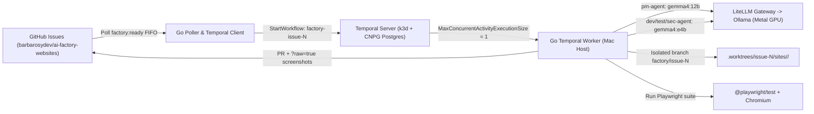
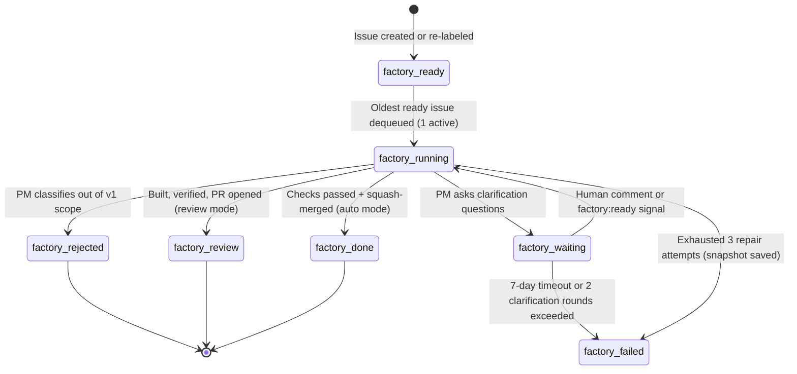

# ai-factory Architecture

`ai-factory` is the Go control plane, Temporal worker, agent orchestrator, and GitHub App poller for the local AI Software Factory. It runs natively on macOS and talks to [`ai-factory-infra`](https://github.com/barbarosydev/ai-factory-infra) (`temporal.localhost:7233`, `http://litellm.localhost:8080/v1`) and [`ai-factory-websites`](https://github.com/barbarosydev/ai-factory-websites).

## End-to-End Flow

## Issue State Machine

## Components

1. **`cmd/factory` (`doctor`, `run`, `once`, `status`, `clean-failed`)**: Entrypoint wiring configuration (`internal/config`), Temporal worker/client (`go.temporal.io/sdk`), GitHub App client, Git worktree manager, Playwright evaluator, and the single-issue FIFO poller.
2. **`internal/githubapp`**: Stdlib `crypto/rsa` RS256 App JWT signer + 1-hour installation token cache paired with `go-github/v93`, GitHub Issue Form markdown parser (`ParseIssueForm`), label/PR state machine (`TransitionIssueState`, `OpenPullRequest`, `AwaitChecksAndMerge`), and clarification reply detector (`ClarificationMarker`).
3. **`internal/workflow` & `internal/activities`**: Deterministic Temporal workflow (`IssueFactoryWorkflow`) with durable signal/timer `Selector` for human clarifications, bounded 3-attempt Dev -> Test -> Review repair loop, and strict credential isolation (zero secrets in Temporal histories).
4. **Four Independent Agents (`internal/agents/{pm,dev,tester,reviewer}`)**:
   - `pm-agent` (`gemma4:12b`): Produces `WebsiteSpecification` JSON Schema or questions/rejection.
   - `dev-agent` (`gemma4:e4b`): Jailed 5-tool (`os.OpenRoot`) file editor inside `sites/<slug>/`.
   - `test-agent` (`gemma4:e4b`): Runs the shared Playwright suite in `../ai-factory-websites` + DOM snapshot inspection (`InspectDOMSnapshot`), diagnoses failures into `FailureEvidence`.
   - `sec-agent` (`gemma4:e4b`): Audits git diff isolation, scans external URLs, verifies spec fidelity, and writes PR summary markdown.
5. **`internal/gitworktree` & `internal/evaluator`**: Manages `factory/issue-<N>` branches, worktrees under `.worktrees/issue-<N>/`, git push via temporary `GIT_ASKPASS` installation token helper, Playwright JSON parsing, and `.worktrees/issue-<N>-failed-<timestamp>/` archival (retaining at most 5 failed snapshots).
