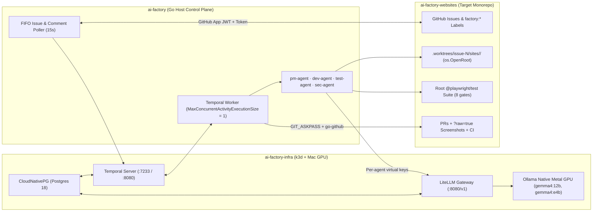
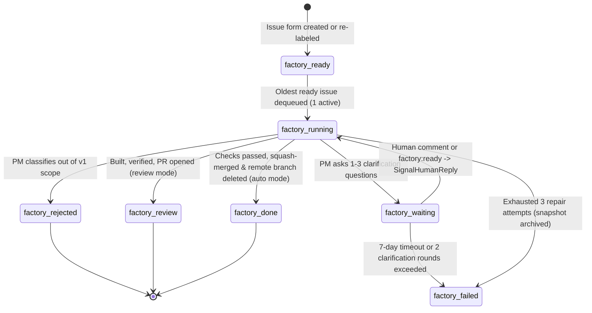

# ai-factory Architecture

`ai-factory` is the Go control plane, Temporal worker, agent orchestrator, and GitHub App poller for the local AI Software Factory. It runs natively on macOS and connects [`ai-factory-infra`](https://github.com/barbarosydev/ai-factory-infra) (`temporal.localhost:7233`, `http://litellm.localhost:8080/v1`) with [`ai-factory-websites`](https://github.com/barbarosydev/ai-factory-websites).

## Three-Repository System View

## Issue Lifecycle State Machine

## Package Architecture

| Package | Responsibility | Key Files |
| --- | --- | --- |
| **`cmd/factory`** | CLI (`doctor`, `run`, `once`, `status`, `clean-failed`) & unified runtime flag handling | [main.go](../cmd/factory/main.go) |
| **`internal/controlplane`** | Temporal worker startup (`MaxConcurrentActivityExecutionSize: 1`), single-issue FIFO scheduler, signal bridge, shared GitHub/doctor/status probes | [runner.go](../internal/controlplane/runner.go), [doctor.go](../internal/controlplane/doctor.go), [status.go](../internal/controlplane/status.go), [github.go](../internal/controlplane/github.go) |
| **`internal/githubapp`** | Stdlib RS256 App JWT signer, 1-hour token cache, Issue Form markdown parser, `IssueController` (PR creation + Checks API wait + squash merge + branch cleanup) | [auth.go](../internal/githubapp/auth.go), [parser.go](../internal/githubapp/parser.go), [client.go](../internal/githubapp/client.go) |
| **`internal/workflow` & `internal/activities`** | Deterministic `IssueFactoryWorkflow` (`workflowcheck` verified) and 15-second background heartbeat wrapper (`startHeartbeatLoop`) keeping long LLM calls alive cleanly | [issue_workflow.go](../internal/workflow/issue_workflow.go), [activities.go](../internal/activities/activities.go) |
| **`internal/agents/{pm,dev,tester,reviewer,llm}`** | Typed contracts & prompts for the 4 independent agents (`pm` normalization + fallback extraction, `dev` `os.OpenRoot` sandbox & scaffold synthesizer, `test` Playwright + DOM bundle, `sec` audit) | [pm.go](../internal/agents/pm/pm.go), [tools.go](../internal/agents/dev/tools.go), [scaffold.go](../internal/agents/dev/scaffold.go), [agent.go](../internal/agents/tester/agent.go), [agent.go](../internal/agents/reviewer/agent.go) |
| **`internal/gitworktree` & `internal/evaluator`** | Isolated `factory/issue-<N>` worktrees, ephemeral `GIT_ASKPASS` pushes, failed snapshot archival (max 5 kept), Playwright JSON parser & URL scanner | [manager.go](../internal/gitworktree/manager.go), [evaluator.go](../internal/evaluator/evaluator.go) |

## Design & Performance Decisions

See [docs/adr/README.md](adr/README.md) for all architecture decision records, especially:
- [ADR 0001](adr/0001-control-plane-language-and-temporal-topology.md): Go control plane + Temporal host worker concurrency (`MaxConcurrentActivityExecutionSize = 1`).
- [ADR 0004](adr/0004-github-app-stdlib-auth-and-human-in-the-loop.md): Pure stdlib GitHub App JWT/Keychain auth without webhooks or tokens in Temporal history.
- [ADR 0005](adr/0005-bounded-self-correction-and-retry-separation.md): Infrastructure retries (`RetryPolicy`) vs bounded 3-attempt semantic self-correction.
- [ADR 0007](adr/0007-gemma4-structured-json-and-high-velocity-skills.md): Avoiding `gemma4:12b` GBNF grammar stalls, 15s background activity heartbeats, and high-velocity `scaffold_site_from_spec` tooling (~17s combined Dev+Test+Review execution).
