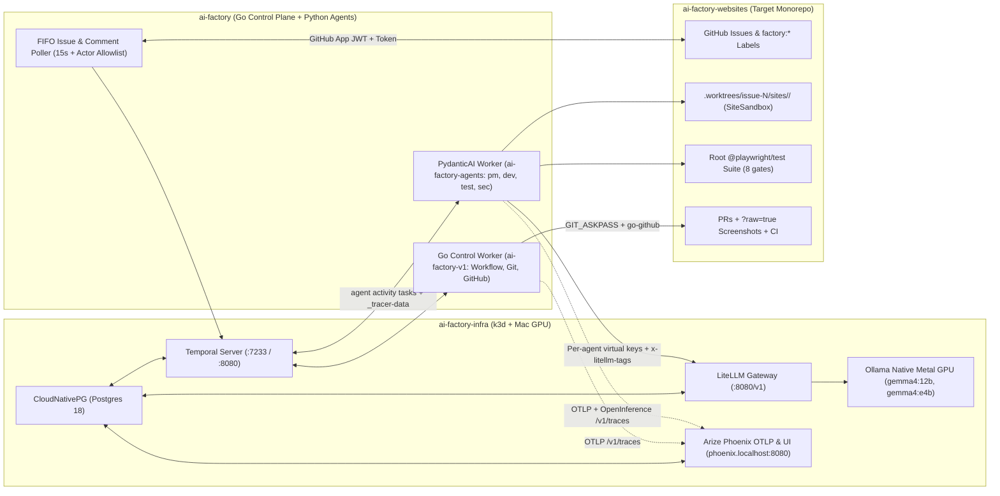
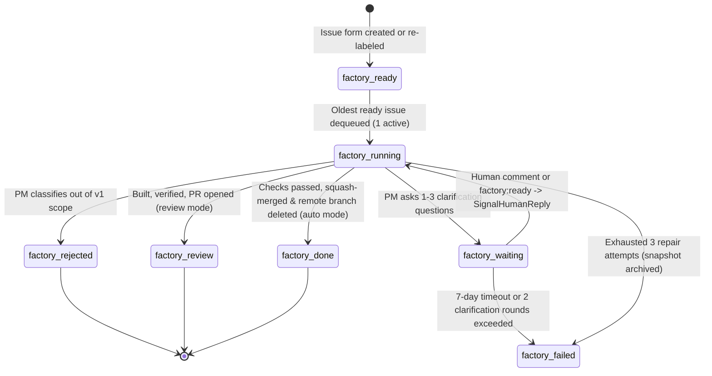

# ai-factory Architecture

`ai-factory` combines a Go control plane and a PydanticAI Python activity worker for the local AI Software Factory. It runs natively on macOS and connects [`ai-factory-infra`](https://github.com/barbarosydev/ai-factory-infra) (`temporal.localhost:7233`, `http://litellm.localhost:8080/v1`) with [`ai-factory-websites`](https://github.com/barbarosydev/ai-factory-websites).

## Three-Repository System View

## Issue Lifecycle State Machine

## Package Architecture

| Package | Responsibility | Key Files |
| --- | --- | --- |
| **`cmd/factory`** | CLI (`doctor`, `run`, `once`, `status`, `clean-failed`) for the control plane | [main.go](../cmd/factory/main.go) |
| **`internal/controlplane`** | Temporal worker startup (`MaxConcurrentActivityExecutionSize: 1`), single-issue FIFO scheduler, signal bridge, shared GitHub/doctor/status probes | [runner.go](../internal/controlplane/runner.go), [doctor.go](../internal/controlplane/doctor.go), [status.go](../internal/controlplane/status.go), [github.go](../internal/controlplane/github.go) |
| **`internal/githubapp`** | Stdlib RS256 App JWT signer, 1-hour token cache, Issue Form markdown parser, `IssueController` (PR creation + Checks API wait + squash merge + branch cleanup) | [auth.go](../internal/githubapp/auth.go), [parser.go](../internal/githubapp/parser.go), [client.go](../internal/githubapp/client.go) |
| **`internal/workflow` & `internal/activities`** | Deterministic `IssueFactoryWorkflow` (`workflowcheck` verified), named cross-language agent activities, GitHub/worktree/PR control activities | [issue_workflow.go](../internal/workflow/issue_workflow.go), [activities.go](../internal/activities/activities.go) |
| **`internal/telemetry`** | OpenTelemetry OTLP HTTP setup, per-issue trace helpers, `/healthz`, `/readyz`, `/metrics`, and `slog` loggers | [tracing.go](../internal/telemetry/tracing.go), [metrics.go](../internal/telemetry/metrics.go) |
| **`agents_py/`** | PydanticAI Temporal Activity Worker on `ai-factory-agents`, OpenInference tracing, dual-mode `SandboxRunner`, direct PydanticAI tools, `SiteSandbox`, secret-scrubbed Playwright, fail-closed QA | [agents.py](../agents_py/src/agents_py/agents.py), [sandbox_runner.py](../agents_py/src/agents_py/sandbox_runner.py), [telemetry.py](../agents_py/src/agents_py/telemetry.py), [workspace.py](../agents_py/src/agents_py/workspace.py), [security.py](../agents_py/src/agents_py/security.py), [worker.py](../agents_py/src/agents_py/worker.py) |
| **`internal/gitworktree`** | Isolated `factory/issue-<N>` worktrees, diff isolation, ephemeral `GIT_ASKPASS` pushes, and failed snapshot archival (max 5 kept) | [manager.go](../internal/gitworktree/manager.go) |

## Design, Observability & Kubernetes Readiness

- **[Observability, Configurability & Agent Evals](observability-and-evals.md)** — Arize Phoenix OpenInference tracing, LiteLLM `/ui/usage/` correlation, Prometheus `/metrics`, `/healthz`, `/readyz`, structured `slog` JSON logs, and tunable `FACTORY_*` variables.
- **Tracing** — W3C `traceparent` propagates from Go through Temporal `_tracer-data` headers into Python PydanticAI + Playwright spans (`FACTORY_OTEL_CAPTURE_CONTENT=false` metadata-only by default), with `Trace ID` recorded on generated PRs ([ADR 0010](adr/0010-opentelemetry-and-phoenix-observability.md)).
- **[Running in Kubernetes / Migrating to AKS](deployment-k8s-aks.md)** — How the stateless Go worker, `/readyz` probes, and `FACTORY_MAX_CONCURRENT_ACTIVITIES` transition cleanly from local macOS host execution to AKS Pods.
- **[Architecture Decision Records](adr/README.md)** — ADRs `0001`–`0010`.
