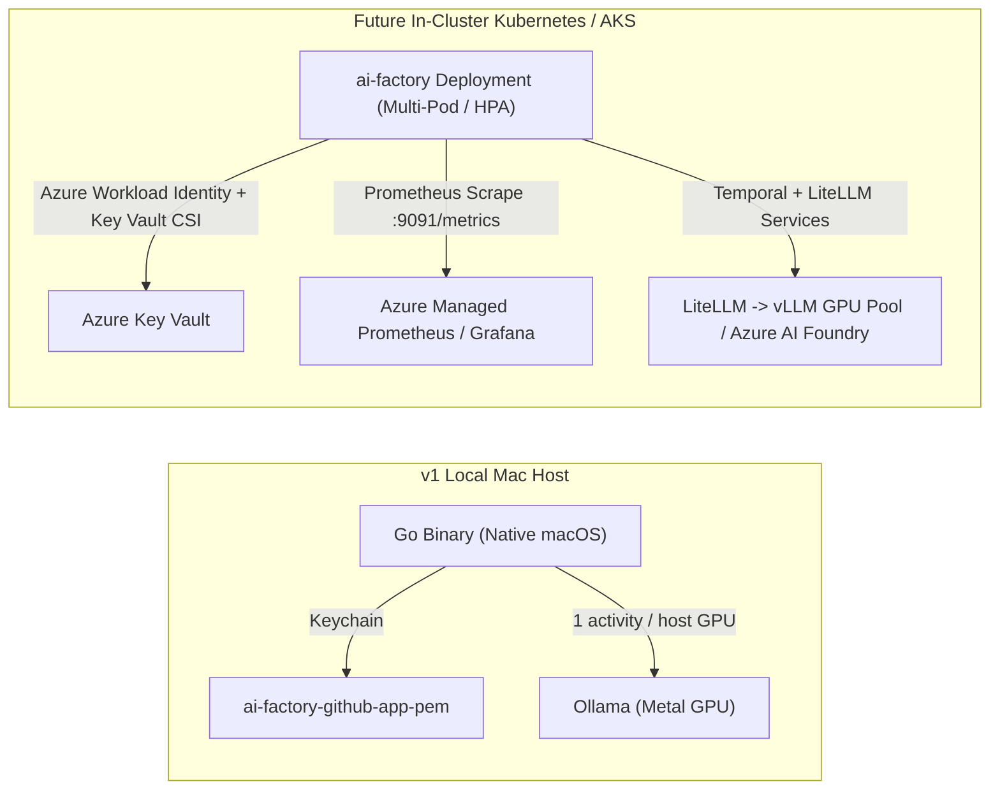

# Running in Kubernetes & Migrating to AKS

## Why v1 Runs Natively on the Mac Host

In v1 ([ADR 0001](adr/0001-control-plane-language-and-temporal-topology.md)), `ai-factory-infra` runs inside k3d (Postgres, Temporal, LiteLLM) while the `ai-factory` Go worker runs directly on macOS so it can share the host Playwright Chromium cache, host `.worktrees/` checkouts, macOS Keychain, and native Apple Silicon Metal GPU without extra container mounts.

At the same time, the Go control plane is already built cleanly for **in-cluster Kubernetes or Azure Kubernetes Service (AKS)** execution:
- Stateless process driven by `FACTORY_*` environment variables
- JSON structured logging (`FACTORY_LOG_FORMAT=json`)
- Native HTTP `/healthz`, `/readyz`, and Prometheus `/metrics` endpoints (`FACTORY_METRICS_ADDR=:9091`)
- Graceful `SIGTERM` drain closing Temporal workers and HTTP listeners cleanly

## Topology Comparison: Local Mac vs AKS



| Concern | v1 Local Mac | Kubernetes / AKS Target |
| --- | --- | --- |
| **Worker Runtime** | Native macOS binary (`bin/factory`) | Distroless/Debian container image containing `factory`, `git`, Node.js, and Chromium |
| **GitHub App Private Key** | macOS Keychain -> injected at `exec` | Azure Key Vault CSI Provider / External Secrets -> `GITHUB_APP_PRIVATE_KEY_BASE64` env or tmpfs mount |
| **Git Worktrees** | Shared `../ai-factory-websites/.worktrees/` | Ephemeral `emptyDir` volume cloned shallowly per pod / per issue |
| **Concurrency** | `FACTORY_MAX_CONCURRENT_ACTIVITIES=1` (single 36 GB Metal GPU) | Increase `FACTORY_MAX_CONCURRENT_ACTIVITIES` or scale Deployment replicas with KEDA Temporal scaler against multi-GPU vLLM or cloud APIs |
| **Observability** | `127.0.0.1:9091/metrics` + `text` logs | `:9091/metrics` ServiceMonitor + `FACTORY_LOG_FORMAT=json` + `/healthz` & `/readyz` probes |

## Reference Kubernetes / AKS Deployment Shape

```yaml
apiVersion: apps/v1
kind: Deployment
metadata:
  name: ai-factory-worker
  namespace: ai-platform
spec:
  replicas: 2
  template:
    metadata:
      annotations:
        prometheus.io/scrape: "true"
        prometheus.io/port: "9091"
        prometheus.io/path: "/metrics"
    spec:
      containers:
        - name: factory
          image: ghcr.io/barbarosydev/ai-factory:<pinned-tag>
          args: ["run", "--mode", "review"]
          env:
            - name: FACTORY_TEMPORAL_ADDRESS
              value: "temporal-frontend.ai-platform.svc:7233"
            - name: FACTORY_LITELLM_URL
              value: "http://litellm.ai-platform.svc:4000/v1"
            - name: FACTORY_METRICS_ADDR
              value: ":9091"
            - name: FACTORY_LOG_FORMAT
              value: "json"
            - name: FACTORY_MAX_CONCURRENT_ACTIVITIES
              value: "4"
          ports:
            - name: metrics
              containerPort: 9091
          livenessProbe:
            httpGet:
              path: /healthz
              port: metrics
          readinessProbe:
            httpGet:
              path: /readyz
              port: metrics
```
