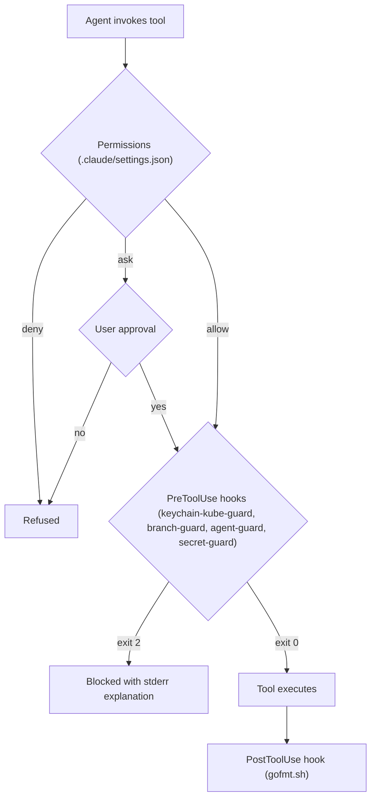

# AI Agent Harness

`ai-factory` ships a Day-0 AI Agent Harness matching `ai-factory-infra` and `ai-factory-websites` ([ADR 0006](adr/0006-agent-harness.md)).

| Piece | File | Purpose |
| --- | --- | --- |
| Rules | [AGENTS.md](../AGENTS.md), [CLAUDE.md](../CLAUDE.md), `.claude/rules/` | Architecture, task commands, hard rules, and path-scoped conventions (`go.md` for the control plane, `python.md` for PydanticAI agents, `prompts.md`, `scripts.md`) |
| Permissions | [.claude/settings.json](../.claude/settings.json) | Allow, ask, and deny rules for tools and shell commands |
| Hooks | `.claude/hooks/` | `keychain-kube-guard.py`, `branch-guard.sh`, `agent-guard.sh`, `secret-guard.sh`, `gofmt.sh`, `session-context.sh` |
| Skills | `.claude/skills/` | `debug-workflow`, `upgrade-version`, `ship-pr` |
| Review agents | `.claude/agents/` | `workflow-reviewer.md`, `security-auditor.md`, `factory-verifier.md` |
| Policies | [policy/README.md](../policy/README.md) | Conftest Rego policies enforcing SHA-pinned workflows and Claude Code guard hooks |

## Tool Call Gates

## Hook Test Suite

`tests/hooks/run.sh` runs during `task test` and `task ci` to verify that every guard hook blocks forbidden actions (reading Keychain passwords or K8s Secret values in shell commands, touching `~/.kube/config`, committing on `main`, running mutating commands inside read-only review agents, or writing secrets) while allowing normal Go development and tests.
