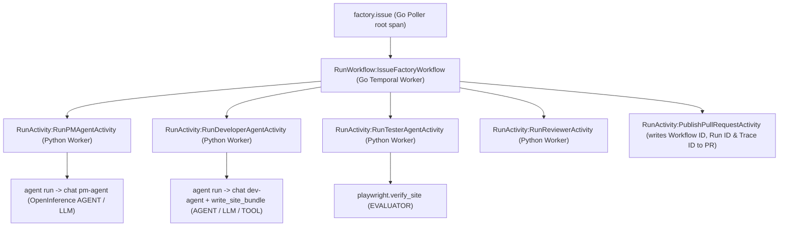

# Observability, Configurability & Agent Evaluation

`ai-factory` combines end-to-end **OpenTelemetry + OpenInference** distributed tracing in **Arize Phoenix** (`http://phoenix.localhost:8080`), **LiteLLM** usage/spend dashboards (`http://litellm.localhost:8080/ui/usage/` and `/ui/logs/`), **Temporal** event histories (`http://temporal.localhost:8080`), and Go control-plane Prometheus `/metrics`.

## 1. End-to-End Distributed Tracing (Arize Phoenix + OpenInference)

Both processes export OTLP HTTP/protobuf spans directly to Arize Phoenix under the `ai-factory` project (`openinference.project.name = "ai-factory"`), stitched across Go and Python via Temporal's `_tracer-data` W3C `traceparent` header ([ADR 0010](adr/0010-opentelemetry-and-phoenix-observability.md)):



### Privacy & Resilience Defaults

- **Metadata-only by default (`FACTORY_OTEL_CAPTURE_CONTENT=false`)**: Spans record workflow/activity names, model routes, token counts, tool names, latencies, status codes, and `playwright.verify_site` pass/fail counts while omitting untrusted GitHub issue text, system prompts, completions, and file-write payloads. Set `FACTORY_OTEL_CAPTURE_CONTENT=true` temporarily when debugging prompt behavior locally.
- **No W3C Baggage & scrubbed child env**: Only W3C `traceparent`/`tracestate` headers propagate; `clean_exec_env()` strips `OTEL_*` and `PHOENIX_*` before spawning Playwright or git subprocesses.
- **Fail-open runtime, fail-fast `doctor`**: Bounded `BatchSpanProcessor` queues drop spans with rate-limited warnings if Phoenix is unreachable so active factory runs never crash, whereas `task doctor` fails fast unless `OTEL_SDK_DISABLED=true`.
- **PR Provenance**: Every generated Pull Request records `Temporal Workflow`, `Run ID`, and `OpenTelemetry Trace ID` in its summary for instant lookup in Temporal Web UI and Phoenix UI.

---

## 2. Offline AI Evaluation & Red-Teaming (`task eval` + Promptfoo)

`task eval` ([scripts/eval.sh](../scripts/eval.sh)) runs a 12-case golden dataset and prompt-injection red-team suite ([evals/promptfooconfig.yaml](../evals/promptfooconfig.yaml), [evals/datasets/golden_issues.yaml](../evals/datasets/golden_issues.yaml)) using the production [pm_system.md](../prompts/pm_system.md) prompt against local LiteLLM (`pm-agent` + `sec-agent` LLM-as-a-judge rubric) with Promptfoo telemetry disabled and `maxConcurrency: 1` ([ADR 0011](adr/0011-systematic-ai-evaluation-with-promptfoo.md)).

## 3. LiteLLM Usage & Spend Correlation (`/ui/usage/` & `/ui/logs/`)

Each Python agent activity attaches per-request correlation headers when calling LiteLLM:

- `x-litellm-tags: issue-<N>,role:<role>,attempt-<A>,site:<slug>`
- `x-litellm-trace-id: <32-hex-otel-trace-id>`

Because `ai-factory-infra` configures local reference token pricing (`model_info`) and 3-day spend/tag retention on LiteLLM, `http://litellm.localhost:8080/ui/usage/` populates spend charts, per-model breakdowns, virtual-key budget utilization, and **By Tags** filtering out of the box without deploying LiteLLM Lens (`BerriAI/lens` + ClickHouse).

### Querying LiteLLM Postgres Spend Logs (`../ai-factory-infra`)

```sql
SELECT
  model,
  COUNT(*) AS calls,
  ROUND(AVG(EXTRACT(EPOCH FROM ("endTime" - "startTime")))::numeric, 2) AS avg_sec,
  SUM(prompt_tokens) AS prompt_toks,
  SUM(completion_tokens) AS completion_toks
FROM "LiteLLM_SpendLogs"
GROUP BY model
ORDER BY calls DESC;
```

---

## 3. Runtime Probes & Prometheus `/metrics`

When `ai-factory run` or `ai-factory once` starts, a loopback HTTP server runs on `FACTORY_METRICS_ADDR` (default `127.0.0.1:9091`; set `off` to disable):

| Endpoint | Purpose | Kubernetes / AKS Use |
| --- | --- | --- |
| `GET /healthz` | Process liveness (`200 OK`) | `livenessProbe` |
| `GET /readyz` | Temporal worker readiness (`200` when polling, `503` otherwise) | `readinessProbe` |
| `GET /metrics` | OpenMetrics/Prometheus text metrics | `ServiceMonitor` / Azure Managed Prometheus scrape |

### Exposed Metrics

- `ai_factory_ready` — Worker readiness gauge (`1` or `0`)
- `ai_factory_workflows_total{final_state="..."}` — Completed workflows (`review`, `done`, `rejected`, `failed`)
- `ai_factory_workflow_duration_seconds_sum` / `_count` — End-to-end issue duration
- `ai_factory_repair_attempts_total` — Total build/verify attempts consumed

Enable structured JSON logs (`log/slog`) with `trace_id` correlation by setting `FACTORY_LOG_FORMAT=json`.

---

## 4. Configurable Policy & Runtime Environment Variables

Repair caps, wait timeouts, activity timeouts, worker concurrency, and OpenTelemetry settings are configurable via environment variables ([internal/config/config.go](../internal/config/config.go) and [agents_py/src/agents_py/telemetry.py](../agents_py/src/agents_py/telemetry.py)):

| Variable | Default | Meaning |
| --- | --- | --- |
| `FACTORY_MAX_REPAIR_ATTEMPTS` | `3` | Maximum Dev -> Test -> Review iterations per issue |
| `FACTORY_MAX_CLARIFICATION_ROUNDS` | `2` | Maximum human clarification pauses before failing |
| `FACTORY_HUMAN_WAIT_TIMEOUT` | `168h` | Durable Temporal timer before timing out `factory:waiting` |
| `FACTORY_HEARTBEAT_TIMEOUT` | `15m` | Temporal worker heartbeat timeout per activity |
| `FACTORY_PM_TIMEOUT` / `FACTORY_DEV_TIMEOUT` | `45m` / `60m` | Activity `StartToCloseTimeout` for PM and Developer agents |
| `FACTORY_TEST_TIMEOUT` / `FACTORY_REVIEW_TIMEOUT` / `FACTORY_MERGE_TIMEOUT` | `30m` | Activity `StartToCloseTimeout` for Tester, Reviewer, and CI merge wait |
| `FACTORY_AGENT_MAX_RETRIES` / `FACTORY_GITHUB_MAX_RETRIES` | `2` / `4` | Temporal `RetryPolicy.MaximumAttempts` for infra/network faults |
| `FACTORY_MAX_CONCURRENT_ACTIVITIES` | `1` | Worker activity concurrency (`1` for 36 GB Mac; raise on multi-GPU / AKS) |
| `FACTORY_METRICS_ADDR` | `127.0.0.1:9091` | HTTP bind address for `/healthz`, `/readyz`, `/metrics` (`off` to disable) |
| `FACTORY_LOG_FORMAT` | `text` | Structured `log/slog` format (`text` or `json`) |
| `FACTORY_ALLOWED_GITHUB_USERS` | `barbarosydev` | Comma-separated GitHub usernames permitted to trigger issues or send clarification replies |
| `FACTORY_AGENT_TASK_QUEUE` | `ai-factory-agents` | Temporal task queue for Python PydanticAI activities |
| `OTEL_SDK_DISABLED` | `false` | Set `true` to disable OpenTelemetry export and skip the Phoenix `doctor` check |
| `OTEL_EXPORTER_OTLP_ENDPOINT` | `http://phoenix.localhost:8080` | OTLP HTTP base URL (normalized to `/v1/traces` without path doubling) |
| `FACTORY_OTEL_PROJECT_NAME` | `ai-factory` | Phoenix `openinference.project.name` resource attribute |
| `FACTORY_OTEL_CAPTURE_CONTENT` | `false` | Metadata-only spans when `false`; set `true` locally to include prompts/completions/tool args |
| `FACTORY_PHOENIX_URL` | `http://phoenix.localhost:8080` | Local Phoenix UI base URL probed by `task doctor` and referenced in PR summaries |
| `FACTORY_SANDBOX_MODE` | `host` | Playwright execution sandbox mode (`host` or hardened `--network=none` `container`) |
| `FACTORY_SANDBOX_IMAGE` | `mcr.microsoft.com/playwright:v1.52.0-noble` | Container image used when `FACTORY_SANDBOX_MODE=container` |
