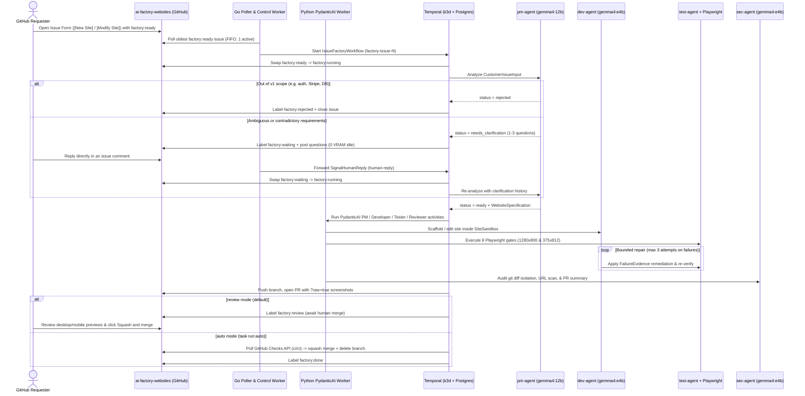

# User & Operator Journey

This guide walks through how a requester ("customer") submits work via GitHub Issues and how a platform operator runs and observes the local AI Software Factory end to end.

## End-to-End Sequence



---

## Journey 1 — Submitting & Reviewing a Request (GitHub Customer)

### Step 1: Open an Eligible Issue Form
In [`barbarosydev/ai-factory-websites`](https://github.com/barbarosydev/ai-factory-websites/issues/new/choose), choose one of the two issue templates:
- **Create a New Website**: provide optional `site_slug`, select a supported business category (`Coffee Shop`, `Bakery`, `Restaurant`, `Barber`, `Photographer`, `Portfolio`, `Consultancy`, `Local Store`, `Event Page`), describe sections/vibe, and list any must-have facts.
- **Modify an Existing Website**: specify the exact `Target Site Slug` under `sites/`, describe requested changes, and list constraints to preserve.

Both templates automatically apply `factory:ready` (only issues carrying `factory:ready` enter the queue).

### Step 2: Watch Label Transitions & Reply if Needed
1. **`factory:running`**: The worker dequeued the oldest `factory:ready` issue into an isolated worktree (`.worktrees/issue-<N>/`) on branch `factory/issue-<N>`.
2. **`factory:rejected`** (closed): Returned cleanly when a request asks for v1 out-of-scope features (OAuth login, PostgreSQL databases, Stripe checkout, backend APIs).
3. **`factory:waiting`**: Returned when requirements contradict each other or essential facts are flagged as missing.
   - Reply in a normal GitHub comment with your answers (you can also edit the issue body and re-add `factory:ready`).
   - While waiting, the Temporal workflow sleeps durably in PostgreSQL with zero local GPU/VRAM usage and wakes automatically within ~15 seconds of your comment.

### Step 3: Approve or Observe Autonomous Merge
- In **`review` mode** (`task run`): the factory opens a Pull Request with spec summary, security audit status, Playwright check results, and rendered desktop/mobile screenshots (`?raw=true`), then labels the issue `factory:review`. Click **Squash and merge** (or run `gh pr merge <PR> --repo barbarosydev/ai-factory-websites --squash --delete-branch`).
- In **`auto` mode** (`task run:auto`): the factory polls the GitHub Checks API until remote GitHub Actions (`ci/ci`) pass, squash-merges the PR automatically, deletes the merged remote branch, and labels the issue `factory:done`.

---

## Journey 2 — Running & Operating the Factory (Mac Operator)

### 1. Boot the Local Infrastructure (`ai-factory-infra`)
```bash
cd ../ai-factory-infra
task up       # starts Ollama + k3d cluster + CNPG Postgres + LiteLLM + Temporal + Arize Phoenix
task doctor   # verifies cluster, Postgres, Ollama, LiteLLM, Temporal, Arize Phoenix, and state secret checks
```

### 2. Verify Factory Readiness & Credentials (`ai-factory`)
```bash
cd ../ai-factory
task build
task doctor   # verifies Websites repo/Playwright, Temporal gRPC, 4 scoped LiteLLM keys, Ollama models, Phoenix OTLP readiness, & GitHub App token
```

### 3. Run the Factory
| Mode | Command | Behavior |
| --- | --- | --- |
| **Human Review Poller** | `task run` | Polls every 15s (FIFO, 1 active issue), opens PR, stops at `factory:review` |
| **Autonomous Poller** | `task run:auto` | Same FIFO poller + waits for GitHub Checks API -> squash-merges & cleans branch (`factory:done`) |
| **Single Issue Run** | `task run:once -- --issue 42` | Runs one issue end-to-end (including clarification signal forwarding) and exits |
| **Status Check** | `task status` | Shows Temporal `IssueFactoryWorkflow` states, Ollama VRAM usage, and open `factory:*` issues |
| **Cleanup Snapshots** | `task clean:failed` | Deletes archived `.worktrees/issue-*-failed-*` debugging folders |

### 4. Inspect Live Telemetry
- **Arize Phoenix UI**: `http://phoenix.localhost:8080` — inspect the single end-to-end trace waterfall (`ai-factory` project) spanning Go `IssueFactoryWorkflow`, Python PydanticAI agent/model/tool calls, and `playwright.verify_site`, using the `Trace ID` recorded in the Pull Request body (metadata-only by default; set `FACTORY_OTEL_CAPTURE_CONTENT=true` for local prompt/completion capture).
- **Temporal Web UI**: `http://temporal.localhost:8080` — inspect workflow event histories, timers, signal arrivals (`human-reply`), and Python activity heartbeats.
- **LiteLLM Admin UI**: `http://litellm.localhost:8080/ui/usage/` and `http://litellm.localhost:8080/ui/logs/` — inspect token spend, virtual-key budget bars, and filter per-issue/per-role calls via `x-litellm-tags` (`issue-<N>`, `role:<agent>`, `attempt-<A>`, `site:<slug>`) and `x-litellm-trace-id`.

---

## Verified Local Portfolio Results (36 GB Apple Silicon Mac)

| Scenario | Live Evidence (`ai-factory-websites`) | Measured Behavior & Timings | Outcome |
| --- | --- | --- | --- |
| **Out-of-Scope Rejection** | Issue #4 (`berlin-marketplace`) | `pm-agent` (`gemma4:12b`) rejected OAuth2/PostgreSQL/Stripe in ~19s -> closed issue in 26s total | `factory:rejected` |
| **Create Website (`review`)** | Issue #5 -> PR #6 (`kaffeekultur-berlin`) | Dev (`5s`) + Playwright 8 gates (`10s`) + Reviewer (`4s`) -> remote CI (`51s`) | `factory:review` -> Merged |
| **Ambiguous -> Clarify -> Auto-Merge** | Issue #7 -> PR #8 (`konditorei-flora-berlin`) | Paused in `factory:waiting` (`20s`), resumed within `8s` of reply comment, auto-merged | `factory:done` |
| **Modify Website (`auto`)** | Issue #9 -> PR #10 (`kaffeekultur-berlin`) | Loaded existing `spec.json`, added Friday Jazz Events + `#2D6A4F` accent, auto-merged | `factory:done` |
